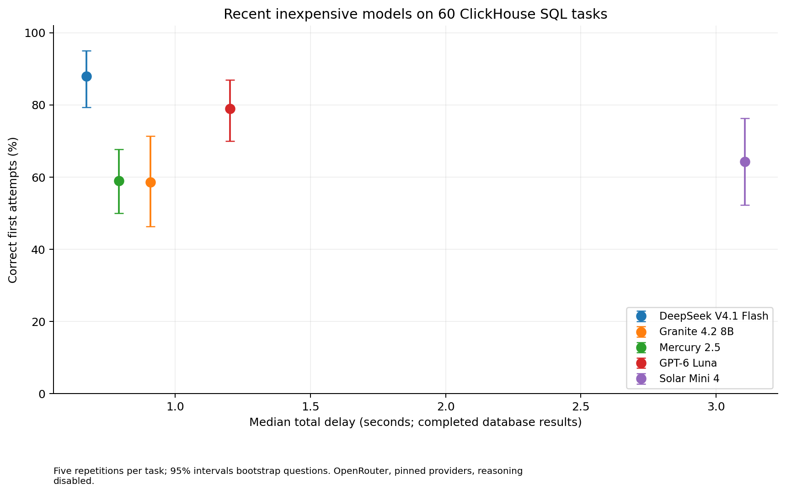
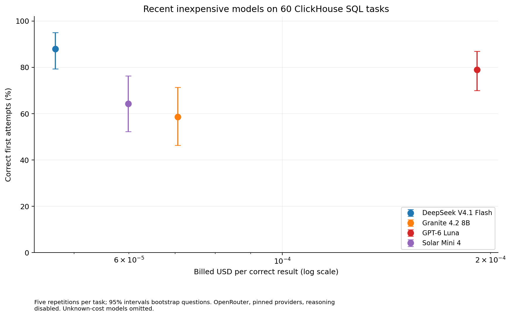
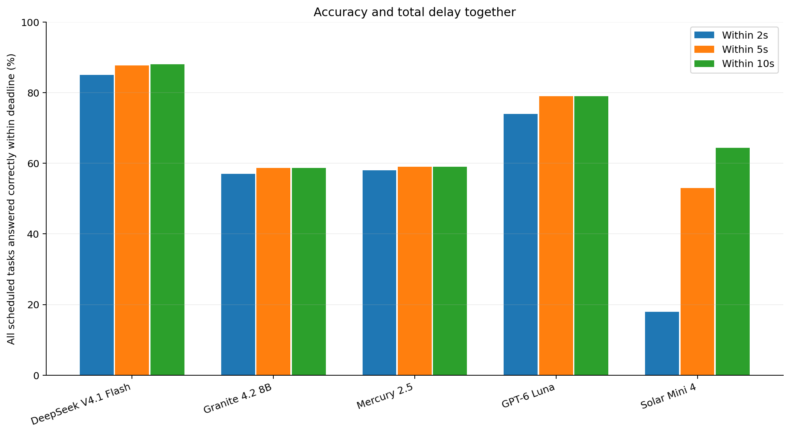

# ClickHouse fast and cheap model benchmark

Phase: full. Attempts: 1500. Complete: True.

Measured 2026-10-07T13:47:19.927985+00:00 through 2026-10-07T14:33:03.559808+00:00 from Falkenstein, Germany.

This run covers the five accessible models. Mistral Large 4, Qwen3.8 Flash remain unmeasured because OpenRouter's account-level zero-data-retention policy blocked their providers. They are not ranked here.

Under the predeclared five-second / near-best-accuracy rule, the recommendation is **DeepSeek V4.1 Flash** on `inference-net/fp8`.

| Model | Correct | Correct ≤5s | Median total [IQR] | p95 total | USD / 1,000 tasks | USD / correct |
| --- | ---: | ---: | ---: | ---: | ---: | ---: |
| DeepSeek V4.1 Flash | 264/300 (88.0%) | 87.7% | 0.672 [0.532, 0.975]s | 1.847s | $0.041 | $0.000047 |
| GPT-6 Luna | 237/300 (79.0%) | 79.0% | 1.202 [1.040, 1.462]s | 2.175s | $0.151 | $0.000191 |
| Solar Mini 4 | 193/300 (64.3%) | 53.0% | 3.106 [1.917, 4.228]s | 7.776s | $0.039 | $0.000060 |
| Mercury 2.5 | 177/300 (59.0%) | 59.0% | 0.792 [0.684, 1.050]s | 1.456s | unknown | unknown |
| Granite 4.2 8B | 176/300 (58.7%) | 58.7% | 0.909 [0.734, 1.176]s | 1.704s | $0.041 | $0.000071 |

Total delay runs from the OpenRouter request start through receipt and parsing of the ClickHouse result. Quantiles cover successful database executions, including incorrect answers. Errors and timeouts remain in accuracy and deadline denominators. Reported costs include failed attempts where billing is known; missing billing remains unknown.

The recommendation first keeps models within five percentage points of the best accuracy, then within five points of that group's best five-second success rate, and chooses the lowest cost per correct result within five seconds. This is a declared workload preference, not a universal ranking.

All models use their pinned provider and the lowest available reasoning mode (disabled here). Cached-token usage and promotional endpoint rates are recorded; prices are not permanent. The fixture and explicit output contracts differ from the earlier published benchmark, so scores are not directly comparable. The observations cover one client region and this measurement period.

Confidence intervals in summary.json and the figures resample questions with their repetitions together. The study has 60 distinct tasks, not 300 independent questions per model.

## Providers and generation speed

| Model | Pinned provider | Reported precision | Median first content | Median visible tokens/s | API errors | SQL errors |
| --- | --- | --- | ---: | ---: | ---: | ---: |
| DeepSeek V4.1 Flash | `inference-net/fp8` | fp8 | 0.498s | 755.9 | 0 | 25 |
| Granite 4.2 8B | `coreweave/bf16` | bf16 | 0.329s | 114.3 | 0 | 108 |
| Mercury 2.5 | `inception` | unknown | 0.765s | 5524.5 | 45 | 61 |
| GPT-6 Luna | `openai/fast` | unknown | 0.780s | 186.7 | 0 | 57 |
| Solar Mini 4 | `upstage/zdr` | unknown | 1.153s | 36.0 | 0 | 73 |

Precision is reported by OpenRouter, not independently verified. Unknown means the provider does not disclose it. Tokens/s is a streaming estimate and is not directly comparable across tokenizers or chunking schemes; complete-result delay drives the recommendation.

## Billing evidence

| Model | Known billed USD | Attempts without cost | Cached input share | Uncached estimate / 1,000 tasks | Endpoint discount field |
| --- | ---: | ---: | ---: | ---: | ---: |
| DeepSeek V4.1 Flash | $0.012404 | 0 | 82.9% | $0.083 | 0% |
| Granite 4.2 8B | $0.012424 | 0 | 93.7% | $0.065 | 0% |
| Mercury 2.5 | $0.007295 | 45 | 0.0% | $0.024 | 80% |
| GPT-6 Luna | $0.045325 | 0 | 0.0% | $0.151 | 0% |
| Solar Mini 4 | $0.011552 | 0 | 0.0% | $0.039 | 50% |

Uncached estimates apply the saved endpoint rates to returned token counts, without a cache discount. They cover known usage only and cannot resolve missing error billing. Endpoint promotions are already reflected in those saved rates; the discount field is shown separately and is not applied a second time. Infrastructure and screening/pilot costs are excluded from model cost comparisons.

See [methodology](../../METHODOLOGY.md), [complete summary](summary.json), [per-tier results](by-tier.csv), [per-question results](by-question.csv), [variation across repetitions](by-repetition.csv), and [individual failures](failures.csv).

The recommended model answered 150/150 attempts correctly across tiers 1–3, but only 25/50 in tier 6. Its lead does not make advanced ClickHouse SQL reliable without validation.

## Figures

